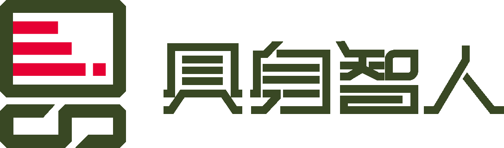

具身智人机器人开发资源中心，面向机器人开发者、科研人员及行业合作伙伴，汇集机器人 SDK、仿真平台、URDF 模型、示例代码与开发指南，涵盖运动控制、状态获取、环境感知、导航及外设集成等开发方向。同时提供环境配置、部署调试、接口调用与常见问题说明，帮助开发者快速上手机器人平台，开展算法验证、二次开发与应用集成。

## SDK 项目

| 项目 | 中文简介 | 我的 Fork |
| --- | --- | --- |
| genisom_robot_sdk | GENISOM 第二代机器人 SDK，面向 M1 及后续平台；当前官方 README 提供 M1、L2 系列的 C++17 客户端库、状态与传感器数据读取、运动与设备控制，以及示例和中英文文档。 | [matianfeng/genisom_robot_sdk](https://github.com/matianfeng/genisom_robot_sdk) |
| genisom_L1_sdk | Genisom-AI L1 系列官方 SDK，提供机器人高层控制接口、实时传感器状态查询、控制权仲裁和示例程序；官方介绍说明提供长期支持与维护。 | [matianfeng/genisom_L1_sdk](https://github.com/matianfeng/genisom_L1_sdk) |

来源与使用说明（点击展开）

- 上述项目均来源于 zsibot 官方账号，原作者及相关权利人的署名、版权声明和许可证保持原样。
- “我的 Fork”为通过 GitHub 原生 Fork 创建的个人副本，保留上游来源关系与提交历史；本次整理未修改 SDK 项目代码。
- 使用、修改和分发各项目时，请以对应仓库实际包含的许可证、版权声明及官方文档为准；本导航不另行授予 SDK 使用许可。
- 机型支持、系统版本兼容性、安装步骤和最新维护状态，请查阅官方源仓库的 README、文档及发布记录。

